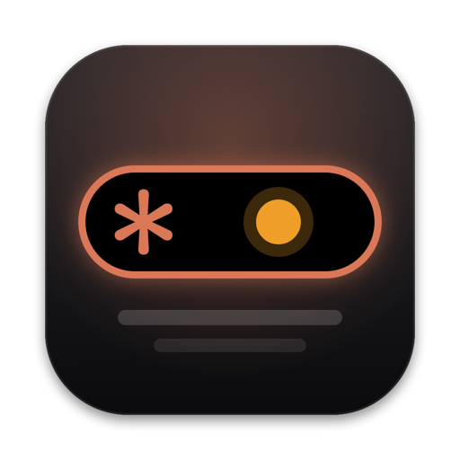

<p align="center"></p>

# 💊 ClaudePill

[](https://www.apple.com/macos/)
[](https://swift.org)
[](LICENSE)

> **A menu bar pill that shows which Claude Code sessions are working, and which one is waiting for you.**


🎬 Full-quality video: [agentpill-story.mp4](promo/agentpill-story.mp4)

## 💡 For Non-Technical Users

**Think of it as a small status light for all your Claude Code sessions, sitting in the menu bar.**

🔍 **The Problem**: You run Claude Code in several projects at once, in the Claude app or the terminal. One of them finished ten minutes ago and has been waiting for you ever since, but you were reading something else.

✨ **The Solution**: ClaudePill listens to Claude Code's own hooks. When a session needs approval or has answered, the pill turns orange, a card tells you which project and what it needs, and one click takes you there.

**Perfect for**: Anyone who keeps several Claude Code sessions running while doing other work.

> 💙 Using GitHub Copilot in VS Code? The sibling app **AgentPill** (repo [`vs-code-ai-os-widget`](https://github.com/madebypatrik/vs-code-ai-os-widget)) does the same for VS Code, in VS Code blue. Both can run side by side, and their cards never overlap.

## ⚡ What This Does

- 🟠 **Lives in the menu bar** — a small pill in Claude orange with status, project and waiting time
- 📋 **Every session at a glance** — see which projects are working and which are waiting
- ✋ **Exact approvals** — uses Claude Code's `PermissionRequest` hook, so there is no guessing
- 🫧 **Calm reminder** — the card shows for 10 seconds, then the pill keeps breathing softly until you answer
- 🙈 **Stays out of the way** — no card while the Claude app is already in front, only the pill
- ⏰ **Snooze** — "Påminn om 5 min" or × hides the card; it comes back if Claude is still waiting
- 🔒 **Local only** — no AI, no cloud, nothing leaves your Mac
- 🚀 **Starts at login**

## 🚦 States

| Claude Code event | Pill shows |
|---|---|
| `SessionStart` | Ready (the session appears in the list) |
| `UserPromptSubmit`, `PostToolUse` | 🟢 *Arbetar* — working |
| `PermissionRequest`, `Notification` (`permission_prompt`) | 🟠 *Väntar på godkännande* |
| `PreToolUse` for `AskUserQuestion` / `ExitPlanMode` | 🟠 *Claude har en fråga* |
| `Stop`, `Notification` (`idle_prompt`) | 🟢 *Din tur* — your turn |
| `SessionEnd` | Session removed |

The UI is in Swedish.

## 🚀 Quick Start

### What You Need
- macOS 14 (Sonoma) or later
- Xcode command line tools (`xcode-select --install`)
- Claude Code (the Claude desktop app's Code tab or the CLI)

---

### Option 1 — With Claude Code *(recommended)*

Open [Claude Code](https://claude.ai/claude-code) in a folder of your choice and say:

> *"Clone this repo, build ClaudePill and install it"*

---

### Option 2 — Without AI

**1. Download and install**
```bash
git clone https://github.com/madebypatrik/claude-ai-os-widget.git
cd claude-ai-os-widget
scripts/install.sh
```
This builds the app, copies it to `/Applications`, turns on start at login and adds the hooks to `~/.claude/settings.json`.

**2. Start a new Claude Code session** — hooks apply to sessions started after the install.

## 🎬 Day-to-Day Use

- **Left click** the pill to open or close the card
- **Right click** for settings, hooks and quit
- **Öppna Claude** brings the Claude app forward and closes the card
- **Påminn om 5 min** hides the card for 5 minutes, **×** for 2 minutes

### Try it without Claude Code
```bash
scripts/send-test-event.sh flow       # the whole flow
curl -s 127.0.0.1:47824/state         # current state as JSON
```

## 🛠️ How It Works

```
Claude Code ──hook──▶ ~/.claudepill/report.sh ──POST──▶ 127.0.0.1:47824 ──▶ ClaudePill
```

1. The installer merges ClaudePill's hooks into `~/.claude/settings.json`. Your existing hooks are kept, and the file is backed up to `~/.claude/settings.json.claudepill.bak` first. A file that cannot be parsed is never overwritten.
2. `report.sh` forwards each hook payload to the app on localhost and always exits 0, so it can never block Claude.
3. A pure state machine turns events into states per session.

### Development
```bash
swift test                                           # state machine, hook decoding, HTTP parser
.build/debug/ClaudePill --render-previews <dir>      # PNGs of the pill and card in every state
scripts/make-icon.sh                                 # regenerate Resources/AppIcon.icns
scripts/build-app.sh --dmg                           # build/ClaudePill.app + .dmg
```

| Folder | Contents |
|---|---|
| `Sources/ClaudePillCore` | Pure logic: `HookEvent`, `Session`, `StateMachine`, `HTTPRequestParser` |
| `Sources/ClaudePill/App` | `@main`, `AppDelegate`, `SessionStore`, `AppSettings` |
| `Sources/ClaudePill/UI` | Pill, card, panel, status item, onboarding, settings |
| `Sources/ClaudePill/Services` | `EventServer`, `FocusWatcher`, `Notifier`, `HookInstaller`, `ClaudeLauncher` |

## 🔒 Security and Privacy

- No AI and no network beyond localhost. Nothing is sent from your Mac.
- The server listens on `127.0.0.1` only. Requests with an `Origin` header (every browser request) are rejected with 403.
- Any program on your Mac can post an event to the port. That only affects what the pill shows.
- The hook script never writes to stdout, so it cannot inject anything into Claude's context.

### Uninstall
```bash
/Applications/ClaudePill.app/Contents/MacOS/ClaudePill --uninstall-hooks
/Applications/ClaudePill.app/Contents/MacOS/ClaudePill --unregister-login-item
rm -rf /Applications/ClaudePill.app
```

## 🧩 Claude Code Skills

This repo ships with git skills in `.claude/skills/`, and project rules for the agent in [CLAUDE.md](CLAUDE.md). Every skill shows you what it will do and waits for your approval.

| Skill | What it does | Example |
|---|---|---|
| `git-branch` | Creates a `feature/`, `fix/` or `chore/` branch | *"Start a branch for the snooze setting"* |
| `git-commit` | Stages the right files and drafts a commit message for review | *"Commit this"* |
| `git-push` | Pushes the branch and sets the upstream if needed | *"Push it"* |
| `git-pr` | Opens a pull request against `main` with summary and test steps | *"Open a PR"* |
| `git-ship` | Commit, push and PR in one guided flow | *"Ship it"* |

## 🤝 Contributing

Improvements welcome!
1. Fork the repository
2. Create your feature branch
3. Run `swift test`
4. Submit a pull request

## 📄 License

MIT License — free to use and modify. See [LICENSE](LICENSE).

---

⭐ **Star this repo if it saves you from a waiting session!**

*Built by [@madebypatrik](https://github.com/madebypatrik) - Built with [Claude Code](https://claude.ai/claude-code)*
